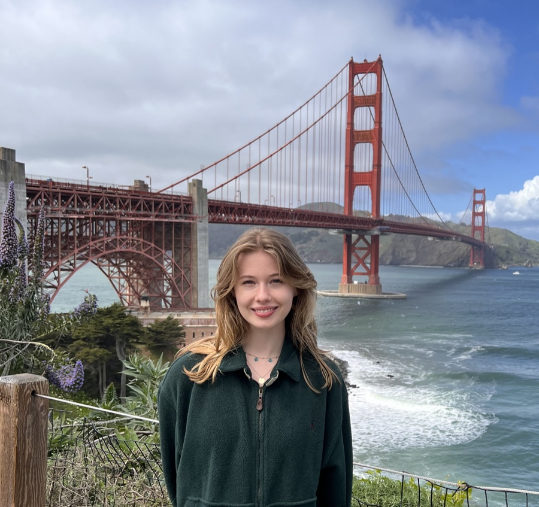

  
  

    <h1>Hi, I'm Meghan!</h1>
    

       I'm a Software Engineer based in San Francisco. I'm originally from Boston, but I moved to California after graduating from the University of Illinois Urbana-Champaign with a degree in Computer Science!
         
       Since graduating, I've enjoyed working as a Software Engineer and tackling a wide range of technical challenges. I've always loved problem-solving, but through my experience, I've discovered that I'm especially drawn to larger-scale problems that require collaboration, thoughtful decision-making, and finding solutions that work for everyone involved.
         
       I'm excited to keep learning, take on new challenges, and apply my technical background to building products that solve meaningful problems. I'm particularly interested in opportunities where I can combine technical problem-solving with collaboration and a broader perspective on how products are built.
    

  

  <button type="button" class="bubble bubble-square bubble-edu" aria-expanded="false" aria-controls="bubble-panel-edu">
    <svg class="bubble-icon" width="22" height="22" viewBox="0 0 24 24" fill="none" stroke="currentColor" stroke-width="1.6" stroke-linecap="round" stroke-linejoin="round" aria-hidden="true"><path d="M22 10 12 5 2 10l10 5 10-5z"/><path d="M6 12v5c0 1.1 2.7 3 6 3s6-1.9 6-3v-5"/><path d="M22 10v6"/></svg>
    Education
    University of Illinois Urbana-Champaign
    Bachelor of Science in Computer Science
    2020 – 2023
  </button>

  

    
I studied Computer Science at the University of Illinois Urbana-Champaign and loved my time there, especially getting involved in cybersecurity clubs on campus. I-L-L!

    <a href="/resume" class="bubble-panel-link">View resume &rarr;</a>
  

  <button type="button" class="bubble bubble-square" aria-expanded="false" aria-controls="bubble-panel-everfox">
    Experience
    Everfox
    
      Software Engineering InternMay 2023- December 2023
      <svg width="12" height="12" viewBox="0 0 24 24" fill="none" stroke="currentColor" stroke-width="2.2" stroke-linecap="round" stroke-linejoin="round"><line x1="12" y1="4" x2="12" y2="20"/><polyline points="6 14 12 20 18 14"/></svg>
      Software Engineer IJanuary 2024 – Janurary 2025
      <svg width="12" height="12" viewBox="0 0 24 24" fill="none" stroke="currentColor" stroke-width="2.2" stroke-linecap="round" stroke-linejoin="round"><line x1="12" y1="4" x2="12" y2="20"/><polyline points="6 14 12 20 18 14"/></svg>
      Software Engineer IIJanurary 2025 – Present
    
  </button>

  

    
I started at Everfox as an intern on the Trusted Thin Client team, working on customer-driven projects to improve the user experience when working across different security classification levels. I also began developing a hardware testing suite that I later led as an intern project, which was ultimately adopted by the testing organization.

    
After joining full-time, I took on broader responsibilities, from organizing and expanding the company's internship program to leading the development and rollout of Magic Mirror. I worked closely with teams across engineering to understand their needs, shape the product's direction, and guide it from an early proof of concept to a tool relied on across the organization. Through these experiences, I discovered how much I enjoy not just solving technical problems, but also figuring out what needs to be built, bringing people together, and guiding projects from idea to execution.

    <a href="/resume" class="bubble-panel-link">View resume &rarr;</a>
  

  <button type="button" class="bubble bubble-square" aria-expanded="false" aria-controls="bubble-panel-ml">
    Experience
    ML / AI
    
      Machine Learning Intern &middot; Pointerra3DMay 2021 – May 2023
      <svg width="12" height="12" viewBox="0 0 24 24" fill="none" stroke="currentColor" stroke-width="2.2" stroke-linecap="round" stroke-linejoin="round"><line x1="12" y1="4" x2="12" y2="20"/><polyline points="6 14 12 20 18 14"/></svg>
      Machine Learning Consultant &middot; Private ClientSeptember 2025 – January 2026
    
  </button>

  

    
I started working as a Machine Learning Intern at Pointerra3D in college. I got to explore how machine learning could be used to understand and predict changes in 3D vegetation data. I worked on everything from preparing the data to experimenting with different models, and was able to greatly improve prediction accuracy. I also built a tool to turn the results into 3D visualizations, making it easier to see what the models were predicting.

    
A few years later I was asked to consult for a startup founded by a former colleague, where I was tasked with defining the machine learning strategy for a new project. I worked with the technical lead to understand the business goals and technical constraints, evaluate different approaches, and determine the best direction for the product. By testing and comparing potential solutions, I developed a recommendation and roadmap to guide the project toward production

    <a href="/resume" class="bubble-panel-link">View resume &rarr;</a>
  

## Hobbies

  Swimming
  

  Jewelry
  

  Running
  

  Volo
  

  Baking
  

  Luna
  

  
  

